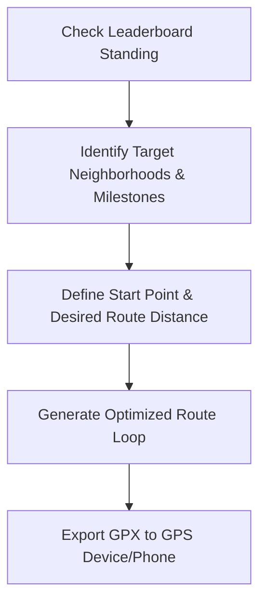

# Wandrer.earth Leaderboard Analysis Tool Design

## 1. Player Value
* **Motivation:** Visual progress, ranking climb, discovery of new areas. Gamification drives local exploration.
* **Monthly Resets:** Fresh start each month. Level playing field. High engagement loop for active players chasing monthly badges.
* **Bonus Points:** Big rewards for hitting specific milestones (e.g., 25%, 50%, 99% completion of cities or neighborhoods). Strategic incentive to target specific areas.

## 2. Route Optimization
* **Low-Hanging Fruit:** Detect regions with high density of unmapped roads close to user location.
* **Efficiency Scoring:** Rank neighborhoods by `unmapped_miles / square_mile` to find dense networks.
* **Smart Routing:** Solve modified rural postman problem. Connect disjoint unmapped segments with minimal repeats. Maximize new miles per total activity distance.

## 3. Workflow

* **Step 1:** View leaderboard standings, local completion percentages, and progress toward next milestone bonuses.
* **Step 2:** Highlight high-yield neighborhoods (low completion, high density).
* **Step 3:** Define start location and target mileage.
* **Step 4:** System generates optimized loop maximizing new coverage.
* **Step 5:** Click export to send GPX to Garmin, Wahoo, or Strava.
